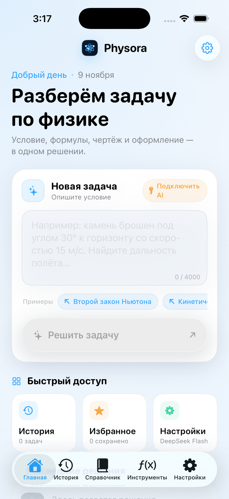
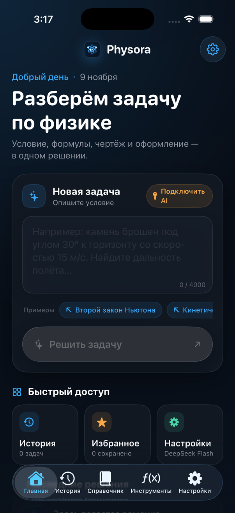

# Physora

[](https://github.com/pepelRU/Physora/actions/workflows/build.yml)

**Physora** — нативный iOS-решатель задач по школьной физике. Он не только получает ответ от DeepSeek, но и собирает из структурированного JSON полноценное оформление: «Дано», «Найти», СИ, формулы, пошаговое решение, программно построенные чертежи и графики, ответ и пояснение.

<p align="center">
  
</p>

## Скачать IPA

**[Скачать Physora.ipa](https://github.com/pepelRU/Physora/releases/download/latest/Physora.ipa)** — unsigned-сборка для iOS 26+ (arm64, около 2,8 МБ), собранная GitHub Actions.

Сборка не подписана Apple Development-сертификатом. Для установки используйте LiveContainer/аналогичное окружение либо откройте `Physora.xcodeproj` и запустите приложение со своей Development Team. Обычный iPhone без подписи IPA не установит.

> **Статус:** CI-сборка и unit-тесты проходят на macOS-раннере (Xcode 26.6, iOS 26.5 SDK). В среде разработки на Windows Xcode отсутствует, поэтому проверка выполнялась через GitHub Actions; статус CI и релиз `latest` — источник истины.

---

## Интерфейс

| Светлая тема | Тёмная тема |
|---|---|
|  |  |

Скриншоты сделаны CI в iOS Simulator на стартовом состоянии без API-ключа.

---

## Содержание

- [Скачать IPA](#скачать-ipa)
- [Интерфейс](#интерфейс)
- [Возможности](#возможности)
- [Технологии](#технологии)
- [Требования](#требования)
- [Быстрый старт](#быстрый-старт)
- [Установка на iPhone](#установка-на-iphone)
- [API-ключ DeepSeek](#api-ключ-deepseek)
- [Архитектура](#архитектура)
- [Как устроено решение](#как-устроено-решение)
- [Чертежи и графики](#чертежи-и-графики)
- [PDF](#pdf)
- [Безопасность и конфиденциальность](#безопасность-и-конфиденциальность)
- [Тесты и CI](#тесты-и-ci)
- [Ограничения](#ограничения)
- [Иконка и ресурсы](#иконка-и-ресурсы)
- [Лицензия](#лицензия)

---

## Возможности

### AI-решатель
- Официальный DeepSeek Chat Completions API (`https://api.deepseek.com/chat/completions`).
- Модели `deepseek-flash` и `deepseek-v4-pro` с выбором в настройках.
- JSON-режим, строгая схема ответа, проверка структуры и автоматический ремонтный повтор при повреждённом JSON.
- Тайм-ауты, ограниченные повторы для 429/5xx и сетевых сбоев, понятные русскоязычные ошибки.
- Отмена запроса без зависания интерфейса.
- Честная индикация этапов: приложение не изображает «внутренние стадии» DeepSeek, которых API не передаёт.

### Оформление решения
- Отдельные блоки `problemAnalysis`, `given`, `find`, `siConversions`, `formulas`, `solutionSteps`, `calculations`, `diagrams`, `graphs`, `finalAnswer`, `explanation`, `warnings`.
- Нативный рендерер математики: собственный парсер ограниченного LaTeX-подмножества и SwiftUI-представление дробей, корней, степеней, индексов, греческих символов и векторов.
- Никаких сырых LaTeX-команд или JSON в интерфейсе.
- Копирование всего решения и отдельных шагов/разделов.
- Избранное, повторное решение, изменение размера текста.
- Отдельный печатный PDF-лист формата A4, а не скриншот приложения.

### Чертежи и графики
- Схемы строятся приложением из графических примитивов: линии, стрелки, силы, наклонные плоскости, траектории, блоки, электрические цепи, оптические элементы, углы, пружины, оси и подписи.
- SwiftUI Canvas и Core Graphics, адаптация к светлой и тёмной теме.
- Графики физических зависимостей на Swift Charts.
- AI передаёт только структурированные примитивы, координаты и подписи. Текстовые «заглушки вместо рисунка» не поддерживаются.

### Локальные функции
- Полноценная история на SwiftData: поиск, фильтр избранного, сортировка, удаление, очистка с подтверждением.
- Справочник по семи разделам физики с формулами, обозначениями, единицами, объяснениями и примерами.
- Конвертер единиц для 12 величин, включая температуру по смещённой шкале.
- Научный калькулятор: степени, корни, тригонометрия в градусах/радианах, `log`, `ln`, скобки, научная запись, факториал.
- Всё перечисленное работает без AI и без интернета (кроме самих решений через DeepSeek).

### Дизайн
- iOS 26, SwiftUI, Liquid Glass в навигационном слое.
- Три темы: светлая, тёмная, автоматическая.
- Акцент `#38A9FF`, адаптивные поверхности, SF Symbols, Dynamic Type, Reduce Motion.
- Оригинальная иконка и launch screen.

---

## Технологии

| Слой | Технология |
|---|---|
| Язык | Swift 6 |
| UI | SwiftUI, iOS 26 SDK |
| Хранение | SwiftData |
| Сеть | URLSession, официальный DeepSeek API |
| Секреты | Apple Keychain (`ThisDeviceOnly`) |
| Графики | Swift Charts |
| Чертежи | SwiftUI Canvas, Core Graphics |
| PDF | UIGraphicsPDFRenderer |
| Иконки | SF Symbols |
| Проект | Xcode 26 / XcodeGen |
| Тесты | XCTest |

Сторонних UI-библиотек, WebView, React Native, Flutter или KMP нет.

---

## Требования

- **macOS** с **Xcode 26** и **iOS 26 SDK**.
- **iOS 26.0+** на устройстве или симуляторе.
- Готовый **`Physora.xcodeproj`** уже находится в репозитории.
- **XcodeGen** — опционально, для перегенерации проекта из `project.yml`.
- API-ключ DeepSeek и положительный баланс на платформе DeepSeek.
- Интернет — только для AI-решений и проверки подключения.

---

## Быстрый старт

### Вариант A: открыть готовый Xcode-проект

```bash
git clone https://github.com/pepelRU/Physora.git
cd Physora
open Physora.xcodeproj
```

Схема: **Physora**, минимальная версия: **iOS 26.0**.

### Вариант B: сгенерировать проект

```bash
brew install xcodegen
xcodegen generate
open Physora.xcodeproj
```

или без macOS-зависимого XcodeGen:

```bash
python Tools/generate_xcodeproj.py
open Physora.xcodeproj
```

`project.yml` — декларативная спецификация структуры проекта. Готовый `.xcodeproj` коммитится в репозиторий, поэтому проект можно открыть без XcodeGen. Для воспроизведения спецификации используется XcodeGen, а кроссплатформенный fallback-генератор находится в `Tools/generate_xcodeproj.py`.

### Сборка из терминала

```bash
xcodebuild \
  -project Physora.xcodeproj \
  -scheme Physora \
  -configuration Debug \
  -destination 'generic/platform=iOS Simulator' \
  CODE_SIGNING_ALLOWED=NO \
  build
```

### Тесты

```bash
xcodebuild test \
  -project Physora.xcodeproj \
  -scheme Physora \
  -destination 'platform=iOS Simulator,name=iPhone 17 Pro' \
  CODE_SIGNING_ALLOWED=NO
```

Имя симулятора зависит от установленного runtime. Можно получить список командой `xcrun simctl list devices available`.

---

## Установка на iPhone

1. Откройте проект в Xcode 26.
2. Выберите target **Physora** → **Signing & Capabilities**.
3. Включите **Automatically manage signing** и выберите свою Team.
4. При необходимости измените Bundle Identifier `com.pepelru.physora` на уникальный.
5. Подключите iPhone, выберите его как run destination.
6. Нажмите **Run**. При первом запуске разрешите доверие разработчику в настройках iOS.

Для установки без App Store нужен Apple ID/Development Team. Неподписанный IPA, собранный CI, не устанавливается напрямую на обычный iPhone; его можно использовать только в окружениях, которые принимают неподписанные сборки, либо подписать самостоятельно.

### Готовая unsigned-сборка

- IPA: [Physora.ipa](https://github.com/pepelRU/Physora/releases/download/latest/Physora.ipa)
- Артефакт Actions: **Physora-unsigned-ipa** в последнем запуске **Build & Test**.
- Требуется iOS 26.0+ и arm64-устройство.
- Для LiveContainer: скачайте IPA на устройство и откройте его через LiveContainer (или подпишите своим сертификатом).
- Для физического iPhone с Xcode: используйте инструкцию выше, это надёжнее неподписанного IPA.

---

## API-ключ DeepSeek

1. Создайте ключ на [platform.deepseek.com/api_keys](https://platform.deepseek.com/api_keys).
2. В Physora откройте **Настройки → DeepSeek**.
3. Вставьте ключ в поле и нажмите **Сохранить ключ**.
4. Нажмите **Проверить подключение**. Приложение запросит `GET https://api.deepseek.com/models` с вашим ключом и проверит, что выбранная модель доступна.
5. Выберите модель:
   - `deepseek-flash` — быстрее для большинства школьных задач;
   - `deepseek-v4-pro` — для более сложных многошаговых решений.

Ключ:
- хранится только в **Apple Keychain** с `kSecAttrAccessibleAfterFirstUnlockThisDeviceOnly` и `kSecAttrSynchronizable=false`;
- не записывается в UserDefaults, SwiftData, файлы, git или логи;
- удаляется кнопкой **Удалить**;
- передаётся только на `api.deepseek.com` по HTTPS.

> Никогда не коммитьте ключ. `.gitignore` исключает `.env`, локальные xcconfig и секреты, но ключ в приложении вводится исключительно вручную.

### Используемые endpoint'ы

Актуальные официальные документы (проверено в 2026 году):

- Chat Completions: `POST https://api.deepseek.com/chat/completions`
- Models: `GET https://api.deepseek.com/models`
- [Документация API](https://api-docs.deepseek.com/api/create-chat-completion)
- [Список моделей](https://api-docs.deepseek.com/api/list-models)

В запросе используются:
- `model`
- `messages`
- `thinking: { "type": "enabled" }`
- `reasoning_effort: "high"`
- `max_tokens`
- `response_format: { "type": "json_object" }`
- `stream: false`

Приложение не использует несуществующие поля и не выдаёт себя за официальный клиент DeepSeek.

---

## Архитектура

```text
Physora/
├── App/
│   ├── PhysoraApp.swift          # точка входа, SwiftData container
│   ├── AppState.swift            # темы, настройки, навигационные намерения
│   └── RootTabView.swift         # TabView и глобальное оформление
├── Core/
│   ├── AI/
│   │   ├── AIService.swift       # провайдер-независимый протокол и фабрика
│   │   ├── DeepSeekService.swift # URLSession, повторы, JSON, /models
│   │   ├── AIModels.swift        # структура решения и ошибок
│   │   └── AIPromptBuilder.swift # строгий промпт и JSON-контракт
│   ├── Physics/
│   │   ├── PhysicsEngine.swift   # локальная проверка и нормализация решения
│   │   ├── UnitConverter.swift   # 12 категорий единиц
│   │   ├── ScientificCalculator.swift # собственный токенизатор и парсер
│   │   └── FormulaDatabase.swift # офлайн-справочник
│   ├── Rendering/
│   │   ├── FormulaRenderer.swift # LaTeX-подмножество → SwiftUI
│   │   ├── DiagramRenderer.swift # Canvas-примитивы и электрические символы
│   │   ├── GraphRenderer.swift   # Swift Charts
│   │   ├── PDFRenderer.swift     # A4 PDF с пагинацией
│   │   └── SolutionTextFormatter.swift
│   ├── Storage/
│   │   ├── KeychainManager.swift
│   │   └── PersistenceController.swift
│   ├── Design/DesignSystem.swift # цвета, карточки, логотип, glass-компоненты
│   └── Utilities/NumberText.swift
├── Features/
│   ├── Home/
│   ├── Solver/
│   ├── History/
│   ├── Reference/
│   ├── Calculator/               # конвертер и калькулятор
│   └── Settings/
├── Models/
│   ├── SolvedProblem.swift       # @Model, полное решение в Data
│   └── DiagramModels.swift       # DiagramElement / Graph
├── Resources/Assets.xcassets
└── Tests/PhysoraTests
```

Принципы:
- сетевой слой не знает о SwiftUI;
- `AIService` — протокол, поэтому нового провайдера можно добавить без переписывания экранов;
- секреты отделены от настроек;
- SwiftData-модель хранит снимок полного структурированного решения, а не только строку ответа;
- рендеринг отделён от моделей и парсинга;
- физические вычисления конвертера и калькулятора не зависят от сети и AI.

---

## Как устроено решение

DeepSeek вызывается в JSON-режиме и обязан вернуть объект с блоками:

```json
{
  "schemaVersion": 1,
  "topic": "Механика",
  "isPhysicsProblem": true,
  "problemAnalysis": "…",
  "given": [{"symbol": "m", "value": "2", "unit": "кг", "note": "масса"}],
  "find": [{"symbol": "F", "description": "сила", "unit": "Н"}],
  "siNote": "Все величины уже в СИ.",
  "siConversions": [],
  "formulas": [{"name": "Второй закон Ньютона", "expression": "F = ma", "variables": "…", "note": ""}],
  "solutionSteps": [{"title": "…", "explanation": "…", "formula": "F = ma", "calculation": "F = 2 \\cdot 3", "result": "F = 6 Н"}],
  "calculations": [],
  "diagrams": [],
  "graphs": [],
  "finalAnswer": [{"symbol": "F", "value": "6", "unit": "Н"}],
  "explanation": "…",
  "warnings": [],
  "needsDiagram": false
}
```

После получения ответа Physora:
1. извлекает JSON даже из ограждённого Markdown-блока;
2. декодирует поля терпимо к пропущенным необязательным данным;
3. ограничивает размеры массивов и строк;
4. удаляет неподдерживаемые примитивы чертежей;
5. проверяет наличие содержательных разделов;
6. добавляет предупреждение при отсутствии единиц/шагов/однозначного ответа;
7. сохраняет полный JSON в SwiftData;
8. строит нативные SwiftUI-представления.

Раздел «СИ» скрывается, если преобразований нет. Аналогично скрываются пустые блоки.

### Формулы

Вместо показа LaTeX приложение использует собственный парсер ограниченного подмножества:
- `\frac{a}{b}` → вертикальная дробь;
- `\sqrt{x}` → корень;
- `x^2`, `x_0` → степень/индекс;
- `\alpha`, `\Delta`, `\omega` → греческие символы;
- `\cdot`, `\approx`, `\leq`, `\rightarrow` и др.;
- `\text{...}` для единиц.

При копировании строится читаемая Unicode-запись, например `F = (mv²)/(2)`, без LaTeX-команд.

---

## Чертежи и графики

Модель не вставляет картинку и не описывает рисунок словами. Она возвращает примитивы в системе координат `360 × 240`:

```json
{
  "title": "Силы на наклонной плоскости",
  "kind": "incline",
  "width": 360,
  "height": 240,
  "elements": [
    {"type": "line", "x1": 40, "y1": 200, "x2": 320, "y2": 200},
    {"type": "arrow", "x1": 190, "y1": 135, "x2": 190, "y2": 205, "label": "mg", "color": "red"},
    {"type": "label", "x": 48, "y": 40, "text": "α"}
  ]
}
```

Поддерживаются: `line`, `arrow`, `dashedLine`, `circle`, `dot`, `rectangle`, `roundedRectangle`, `polygon`, `polyline`, `curve`, `arc`, `angle`, `spring`, `resistor`, `battery`, `capacitor`, `lamp`, `switch`, `ammeter`, `voltmeter`, `inductor`, `ground`, `label`, `axis`.

Все примитивы валидируются и рисуются в `Canvas`; текст подписей получает подложку для читаемости. Схема адаптируется к ширине экрана и цветовой схеме.

Графики передаются точками и строятся Swift Charts с осями, подписями, сеткой и легендой.

---

## PDF

`SolutionPDFRenderer` создаёт отдельный A4-документ:
- брендированный колонтитул;
- условие;
- анализ, Дано/Найти;
- формулы и шаги;
- чертежи и графики, отрисованные заново в светлой печатной теме;
- ответ в выделенном блоке;
- предупреждения и дисклеймер;
- разбиение длинного текста на страницы.

Текст и формулы остаются векторным текстом (за исключением растровых изображений чертежей и графиков, которые строятся локально). PDF открывается через системный share sheet, откуда его можно сохранить в «Файлы».

---

## Безопасность и конфиденциальность

- Ключ DeepSeek — только Keychain, без iCloud-синхронизации.
- Ключ не пишется в логи и не попадает в SwiftData.
- Сетевые запросы идут только на официальный HTTPS endpoint.
- Нет аналитики, рекламных SDK, WebView и трекинга.
- Условия и решения хранятся локально и не отправляются разработчику.
- При решении условие отправляется в DeepSeek — это необходимо для работы AI. Политика DeepSeek применяется к обработке на их стороне.
- AI-ответ помечается как сгенерированный; приложение не утверждает, что физика гарантированно верна.

Подробности — в экране **Настройки → Политика конфиденциальности**.

---

## Тесты и CI

В `Tests/PhysoraTests` проверяются:
- приоритет операций, степени, скобки, тригонометрия, логарифмы, корни, факториал, ошибки домена;
- преобразования единиц, включая температуру;
- парсер формул и отсутствие утечки LaTeX;
- валидация решений, предупреждения и отбрасывание неподдерживаемых/текстовых чертежей;
- генерация PDF (`%PDF` и содержимое документа);
- сериализация и восстановление полного решения.

GitHub Actions workflow `.github/workflows/build.yml`:
- использует latest-stable Xcode;
- проверяет схему закоммиченного Xcode-проекта;
- собирает **Physora** под iOS Simulator;
- выбирает доступный iPhone-симулятор и запускает XCTest;
- делает скриншоты главного экрана в светлой и тёмной теме;
- собирает unsigned Release-приложение под arm64 iPhone и упаковывает `Physora.ipa`;
- публикует IPA в релизе [`latest`](https://github.com/pepelRU/Physora/releases/tag/latest);
- прикладывает simulator-сборку, скриншоты, логи и result bundle к запуску.

Секреты для CI не требуются: DeepSeek API не вызывается в unit-тестах.

### Как настроить GitHub Actions

1. Форкните/клонируйте репозиторий.
2. Убедитесь, что workflow включён на вкладке **Actions**.
3. При необходимости измените `runs-on` и версию Xcode в `.github/workflows/build.yml` под доступный macOS runner.
4. Запустите **Build & Test** вручную или сделайте push в `main`.
5. Готовый simulator-артефакт и логи можно скачать на странице запуска.

---

## Ограничения

- Требуется iOS 26; на более старых версиях приложение не запустится.
- DeepSeek должен поддерживать выбранную модель и иметь баланс; при 402/429/5xx приложение покажет ошибку.
- AI может ошибаться в физике. Проверка структуры не равна независимому решению задачи.
- Генерация PDF и рендеринг схем выполняются локально на главном потоке короткими этапами; очень большие решения могут занять заметное время.
- Приложение не содержит встроенного API-ключа и не оплачивает запросы пользователя.
- Подпись и установка на физический iPhone требуют Apple Development Team; CI собирает неподписанный проект и не публикует его в App Store.
- В среде разработки на Windows нет Xcode, поэтому финальная проверка компиляции выполняется CI на macOS. README не утверждает, что локальная сборка была выполнена на Windows.

---

## Иконка и ресурсы

Иконка и launch-логотип созданы с нуля скриптом `Tools/generate_assets.py` (Pillow). Используется абстрактный атом с тремя орбитами и электронами; сторонние изображения и торговые марки не применяются. Скрипт воспроизводим и лежит в репозитории.

- `AppIcon` 1024×1024: universal / dark / tinted.
- `LaunchLogo` 1x/2x/3x для light/dark.
- Accent Color `#38A9FF`.
- Внутренний логотип рисуется SwiftUI Canvas.

Чтобы перегенерировать ресурсы:

```bash
python -m pip install pillow
python Tools/generate_assets.py
```

---

## Лицензия

Лицензия не задана. Если планируется публичное распространение или переиспользование, добавьте выбранную лицензию (например MIT) и укажите правообладателя.

---

**Physora** — physics, clearly.
